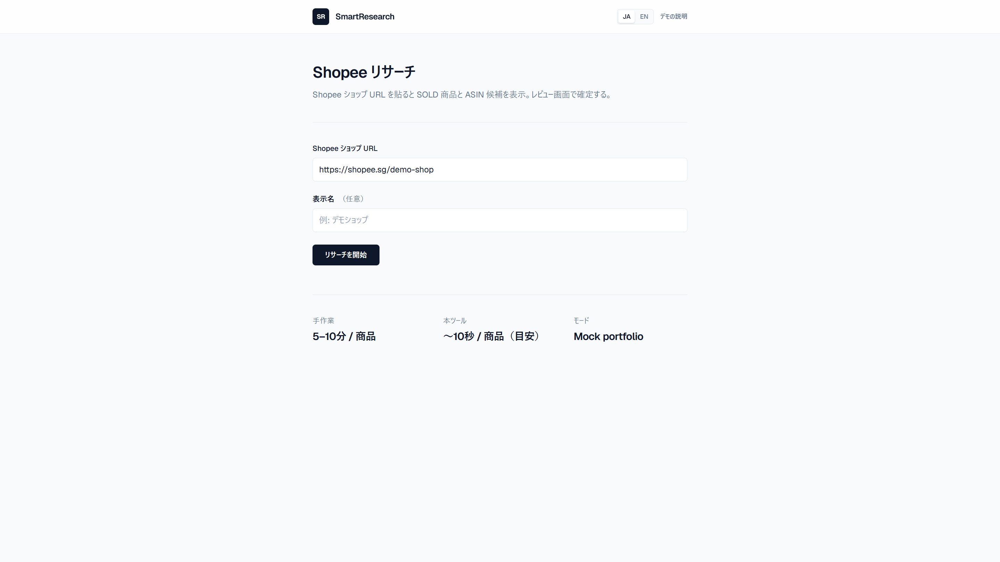
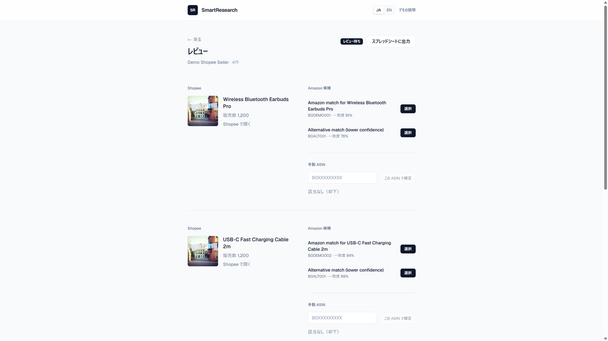

# SmartResearch-HQ: Find products to consider sourcing

[](./README.md) [](./README.en.md)

**Research products on Shopee and find candidates for the same products on Amazon.**  
The app gathers candidates, a person checks the details, and the confirmed results become a list for sourcing decisions.

**[Try the demo](https://smart-research-hq.vercel.app)** · [Service overview and example (9 slides, Japanese)](https://docs.google.com/presentation/d/19menY9qCy_Skjt85iv5y2VLB4bGUbp6h/edit)

> The public demo uses sample data. It does not research live shops or save data to Google Sheets. The presentation may require Google Drive viewing permission.

## Who is this for?

- Sellers considering which products to source domestically and sell overseas
- People who find products on Shopee and then search for each one again on Amazon
- Teams that want to keep research results in a list and hand them over to colleagues

The goal is to reduce product-search work and leave more time for checking costs and deciding what to source. Time savings and sales impact have not been measured.

## How it works

| Step | What the app and the user do |
|---|---|
| 1. Choose a shop | Enter a Shopee shop URL. |
| 2. View candidates | The app displays product information, sold counts, and Amazon product candidates. |
| 3. Check the product | The user checks model, capacity, color, and quantity before selecting a candidate. Enter a product identifier manually or reject the item if no suitable candidate exists. |
| 4. Keep the results | Organize confirmed products in a list. Production features can save it to Google Sheets after initial setup. |

Candidates and match scores do not guarantee that two listings represent the same product. The user makes the final check.

## What do the results contain?

The production export saves these fields to Google Sheets.

| Information | Contents |
|---|---|
| Shopee product | Product title, page link, item ID, and sold count |
| Selected Amazon product | Page link and product identifier (ASIN) |
| Record | Export timestamp |

Open product links from the list to check sourcing prices and shipping costs separately. Another team member can use the same list to continue the research.

## Example: Source on Amazon and sell on Shopee

This is a fictional example. Products, sold counts, and prices are illustrative, not actual research results.

### Find a product to sell overseas

Tanaka wants to source products on Amazon and sell them on Shopee. Unsure what to buy, Tanaka enters the URL of a Shopee household-goods shop.

### Select the same product from the candidates

The results show a 500 mL insulated bottle with 120 units sold, alongside Amazon candidates. Tanaka checks the model, capacity, color, and quantity, then selects the same 500 mL product. A 350 mL candidate is not selected.

Sold count is only one input to the decision. It does not establish future demand.

### Account for shipping and fees

Tanaka opens product links, checks prices, and calculates costs outside the app.

| Item | Illustrative amount (JPY equivalent) |
|---|---:|
| Planned selling price | ¥2,500 |
| Purchase cost | ¥1,100 |
| Shipping | ¥500 |
| Selling fees and similar charges | ¥350 |
| Packaging | ¥150 |
| Amount remaining after these costs | **¥400** |

This is not final profit: taxes, return losses, fixed costs, and other expenses are excluded. If shipping costs ¥900 instead, the remaining amount is zero, so Tanaka would pass under those conditions.

### Decide whether to source it

After checking stock, selling conditions, and costs, Tanaka considers a small purchase only for suitable products. Actual costs and sales after listing inform whether to buy more.

**The app supports product research, candidate suggestions, and organizing confirmed results.** Profit calculations, purchases, listing, and shipping happen outside the app. Sales and profits are not guaranteed.

## Can it support sites other than Shopee?

The current implementation researches Shopee products and finds Amazon candidates. Changing the research site or the site used to find candidates can be considered through additional development.

Feasibility and scope depend on the requested site and information. This is not a settings-only switch to any website; site capabilities, data access methods, and terms may prevent support.

## Screens and walkthrough

**Enter a shop URL**



**Check whether products match and select a candidate**



[Watch the short walkthrough](docs/videos/portfolio-demo.webm)

Product information and scores in the screenshots are samples. Any task-time figures shown are estimates, not measured improvements.

## Public demo versus production features

| Feature | Public demo (Portfolio) | Production |
|---|---|---|
| Product information | Sample data | Retrieved from external sites |
| Amazon candidates | Sample candidates | Search-service integration |
| Product confirmation | User selection | User selection |
| Spreadsheet export | Counts only | Google Sheets integration |
| Getting started | Try in a browser | Configure and verify external integrations |

Production features are not deployed publicly.

---

## For developers: Architecture and modes

FastAPI and Next.js share one codebase, with behavior selected by `APP_MODE`.

- `portfolio`: In-memory sample data; no PostgreSQL, Redis, or API keys required.
- `production`: Playwright, Redis + ARQ workers, PostgreSQL, Amazon search, and Google Sheets. Candidate search is pluggable; the default is Amazon PA-API title search. Gemini is optional.

UI design: [Soft Paper brief](docs/design/brief.md)  
Demo product images: `frontend/public/demo/`

---

## Tech stack

Org policy: **[docs/tech-stack-policy.md](docs/tech-stack-policy.md)** (this repo = **Profile B** — FastAPI pipeline). New business SaaS repos use **Profile A** (Laravel).

*   **Frontend:**   
*   **Backend:**  
*   **Portfolio infra:**  
*   **Production infra:**   

---

## Quick start (local, portfolio)

Postgres and Redis are **not** required.

```bash
bash scripts/bootstrap-local.sh

# Terminal 1 — API
cd backend && source .venv/bin/activate
uvicorn app.main:app --reload --port 8000

# Terminal 2 — UI
cd frontend && npm run dev
```

Open http://localhost:3000 → enter a Shopee shop URL → review candidates → export.

Health: `GET http://localhost:8000/api/v1/health` → `{ "status": "ok", "mode": "portfolio", ... }`

---

## Quick start (local, production — private)

**Not deployed publicly.** Requires Docker (Postgres + Redis), Playwright, and optionally Amazon PA-API keys. Gemini is optional.

```bash
bash scripts/start-production-local.sh
# Edit .env: APP_MODE=production, AMAZON_PAAPI_* (see docs/production-local-setup.md)
```

Full checklist: **[docs/production-local-setup.md](docs/production-local-setup.md)** · M2 smoke: `bash scripts/smoke-m2.sh`

---

## Deploy (portfolio)

1. Apply [render.yaml](render.yaml) on Render (`APP_MODE=portfolio`).
2. Deploy `frontend/` to Vercel; set `NEXT_PUBLIC_API_URL` to your Render API base + `/api/v1`.
3. Set `ALLOWED_ORIGINS` on Render to your Vercel URL(s).

Full checklist: **[docs/deployment-guide.md](docs/deployment-guide.md)**  
Troubleshooting (404, CORS, CLI): **[docs/deployment-troubleshooting.md](docs/deployment-troubleshooting.md)**

One-command redeploy: `bash scripts/portfolio-vercel-deploy.sh redeploy`

---

## Repository layout

```
├── docs/           # Design & architecture
├── frontend/       # Next.js dashboard & review UI
├── backend/        # FastAPI (Mock services in portfolio mode)
├── render.yaml     # Render Blueprint (portfolio API)
├── docker-compose.yml
└── scripts/        # bootstrap, CI, smoke tests
```

---

## Documentation

| Doc | Contents |
|-----|----------|
| [CONTEXT.md](CONTEXT.md) | Domain glossary, security & engineering guardrails |
| [Agent index](docs/agents/README.md) | Security, YAGNI/fail-fast/testability, ADR index |
| [Project plan](docs/プロジェクト計画書.md) | Goals & scope |
| [Architecture](docs/architecture.md) | Two-mode design, data flow |
| [Design](docs/design.md) | UI principles |
| [API specification](docs/api-specification.md) | REST contract |
| [Deployment guide](docs/deployment-guide.md) | Vercel / Render env vars |
| [Tech stack policy](docs/tech-stack-policy.md) | Org Must/Choose; this repo = Profile B |
| [Security scanning](docs/security-scanning.md) | CI secret/CodeQL guardrails |
| [Doc conventions](docs/doc-conventions.md) | Language-specific READMEs; bilingual public docs |
| [Git hooks](docs/git-hooks.md) | Local pre-commit / post-push install |

---

## Development

### Prerequisites

| Item | Notes |
|------|-------|
| OS | **WSL Ubuntu** recommended on Windows (avoid Git Bash + UNC paths) |
| Python | 3.12 |
| Node.js | 20 LTS |
| Docker | Optional — production verification only |

```bash
bash scripts/ci-check.sh   # Ruff + pytest + ESLint + build (mirrors CI)
```

Optional — install tracked git hooks (secret scan + doc validation on commit):

```bash
bash scripts/install-git-hooks.sh
```

See [docs/git-hooks.md](docs/git-hooks.md).

Production verification (optional): copy `.env.example` → `.env`, then `docker compose up -d postgres redis` with `APP_MODE=production`.

### Key environment variables (portfolio)

| Variable | Where | Description |
|----------|-------|-------------|
| `APP_MODE` | Backend | `portfolio` (Mock) or `production` |
| `NEXT_PUBLIC_API_URL` | Frontend | API base URL, e.g. `http://localhost:8000/api/v1` |
| `ALLOWED_ORIGINS` | Backend | Comma-separated CORS origins for deployed frontend |

See `.env.example` for production-only variables (PA-API, Gemini, Sheets).

---

## Roadmap

- [x] Phase 1 — Design, monorepo, docs
- [x] Phase 2 — Scraping, matching, Sheets, workers
- [x] Phase 3 — Job polling, manual ASIN UI
- [x] Phase 4 — Portfolio deploy, Soft Paper UI, screenshots / demo video

---

## License

Private / portfolio use. The portfolio edition omits scraping internals and proprietary prompts.
