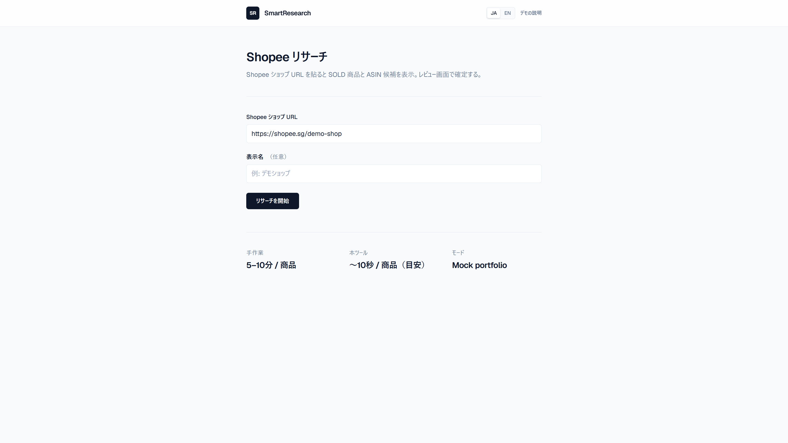
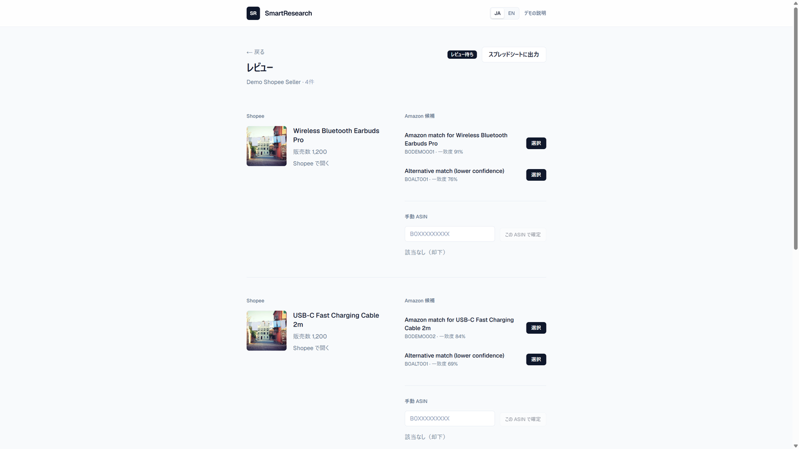

# SmartResearch-HQ

[English](./README.md) | [日本語](./README.ja.md)

[](https://smart-research-hq.vercel.app)
[](https://github.com/hrn-dev-work)

Public markdown conventions: [docs/doc-conventions.md](docs/doc-conventions.md).

Cross-border EC research tool: take a Shopee shop URL, list SOLD items, propose Amazon ASIN candidates, confirm on a review screen, optionally export. One monorepo with **Portfolio** (public Mock demo) and **Production** (private scrape / match / Sheets).

Manual matching often takes **5–10 minutes per item**. The UI targets a short review pass instead. Matching is pluggable; default production path is Amazon PA-API title search (Gemini is optional, not required).

---

## Why two modes in one codebase

| Mode | Audience | Runtime |
|------|----------|---------|
| **Portfolio** (this demo) | Recruiters, clients, reviewers | In-memory Mock — no Postgres, Redis, or API keys |
| **Production** (private ops) | Real cross-border EC workflows | Playwright scraping, Redis + ARQ workers, pluggable matching (PA-API / Gemini), Google Sheets |

`APP_MODE` switches behavior on the same FastAPI + Next.js app. Portfolio keeps the full UI path (research → review → export counts) without secrets. Production adds workers and live integrations.

Header link **About this demo** explains the split (JA / EN). Soft Paper UI tokens: [docs/design/brief.md](docs/design/brief.md).

---

## Screenshots

Live demo: [smart-research-hq.vercel.app](https://smart-research-hq.vercel.app)

**Dashboard** — shop URL → start research



**Review** — Amazon candidates and manual ASIN



Short walkthrough (dashboard → review): [docs/videos/portfolio-demo.webm](docs/videos/portfolio-demo.webm)

Demo product thumbnails live under `frontend/public/demo/` (served as `/demo/*.png`).

---

## Tech stack

Org policy: **[docs/tech-stack-policy.md](docs/tech-stack-policy.md)** (this repo = **Profile B** — FastAPI pipeline). New business SaaS repos use **Profile A** (Laravel).

*   **Frontend:**   
*   **Backend:**  
*   **Portfolio infra:**  
*   **Production infra:**   

---

## Quick start (local, portfolio)

Postgres and Redis are **not** required.

```bash
bash scripts/bootstrap-local.sh

# Terminal 1 — API
cd backend && source .venv/bin/activate
uvicorn app.main:app --reload --port 8000

# Terminal 2 — UI
cd frontend && npm run dev
```

Open http://localhost:3000 → enter a Shopee shop URL → review candidates → export.

Health: `GET http://localhost:8000/api/v1/health` → `{ "status": "ok", "mode": "portfolio", ... }`

---

## Quick start (local, production — private)

**Not deployed publicly.** Requires Docker (Postgres + Redis), Playwright, and optionally Amazon PA-API keys. Gemini is optional.

```bash
bash scripts/start-production-local.sh
# Edit .env: APP_MODE=production, AMAZON_PAAPI_* (see docs/production-local-setup.md)
```

Full checklist: **[docs/production-local-setup.md](docs/production-local-setup.md)** · M2 smoke: `bash scripts/smoke-m2.sh`

---

## Deploy (portfolio)

1. Apply [render.yaml](render.yaml) on Render (`APP_MODE=portfolio`).
2. Deploy `frontend/` to Vercel; set `NEXT_PUBLIC_API_URL` to your Render API base + `/api/v1`.
3. Set `ALLOWED_ORIGINS` on Render to your Vercel URL(s).

Full checklist: **[docs/deployment-guide.md](docs/deployment-guide.md)**  
Troubleshooting (404, CORS, CLI): **[docs/deployment-troubleshooting.md](docs/deployment-troubleshooting.md)**

One-command redeploy: `bash scripts/portfolio-vercel-deploy.sh redeploy`

---

## Repository layout

```
├── docs/           # Design & architecture
├── frontend/       # Next.js dashboard & review UI
├── backend/        # FastAPI (Mock services in portfolio mode)
├── render.yaml     # Render Blueprint (portfolio API)
├── docker-compose.yml
└── scripts/        # bootstrap, CI, smoke tests
```

---

## Documentation

| Doc | Contents |
|-----|----------|
| [CONTEXT.md](CONTEXT.md) | Domain glossary, security & engineering guardrails |
| [Agent index](docs/agents/README.md) | Security, YAGNI/fail-fast/testability, ADR index |
| [Project plan](docs/プロジェクト計画書.md) | Goals & scope |
| [Architecture](docs/architecture.md) | Two-mode design, data flow |
| [Design](docs/design.md) | UI principles |
| [API specification](docs/api-specification.md) | REST contract |
| [Deployment guide](docs/deployment-guide.md) | Vercel / Render env vars |
| [Tech stack policy](docs/tech-stack-policy.md) | Org Must/Choose; this repo = Profile B |
| [Security scanning](docs/security-scanning.md) | CI secret/CodeQL guardrails |
| [Doc conventions](docs/doc-conventions.md) | Language-specific READMEs; bilingual public docs |
| [Git hooks](docs/git-hooks.md) | Local pre-commit / post-push install |

---

## Development

### Prerequisites

| Item | Notes |
|------|-------|
| OS | **WSL Ubuntu** recommended on Windows (avoid Git Bash + UNC paths) |
| Python | 3.12 |
| Node.js | 20 LTS |
| Docker | Optional — production verification only |

```bash
bash scripts/ci-check.sh   # Ruff + pytest + ESLint + build (mirrors CI)
```

Optional — install tracked git hooks (secret scan + doc validation on commit):

```bash
bash scripts/install-git-hooks.sh
```

See [docs/git-hooks.md](docs/git-hooks.md).

Production verification (optional): copy `.env.example` → `.env`, then `docker compose up -d postgres redis` with `APP_MODE=production`.

### Key environment variables (portfolio)

| Variable | Where | Description |
|----------|-------|-------------|
| `APP_MODE` | Backend | `portfolio` (Mock) or `production` |
| `NEXT_PUBLIC_API_URL` | Frontend | API base URL, e.g. `http://localhost:8000/api/v1` |
| `ALLOWED_ORIGINS` | Backend | Comma-separated CORS origins for deployed frontend |

See `.env.example` for production-only variables (PA-API, Gemini, Sheets).

---

## Roadmap

- [x] Phase 1 — Design, monorepo, docs
- [x] Phase 2 — Scraping, matching, Sheets, workers
- [x] Phase 3 — Job polling, manual ASIN UI
- [x] Phase 4 — Portfolio deploy, Soft Paper UI, screenshots / demo video

---

## License

Private / portfolio use. The portfolio edition omits scraping internals and proprietary prompts.
