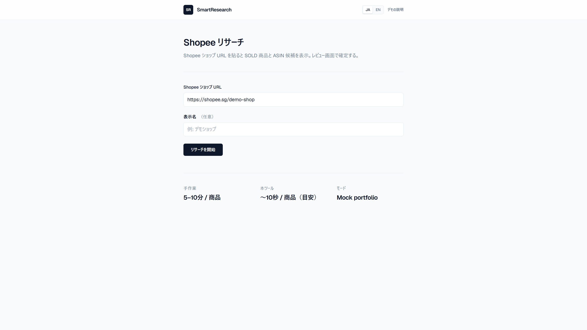
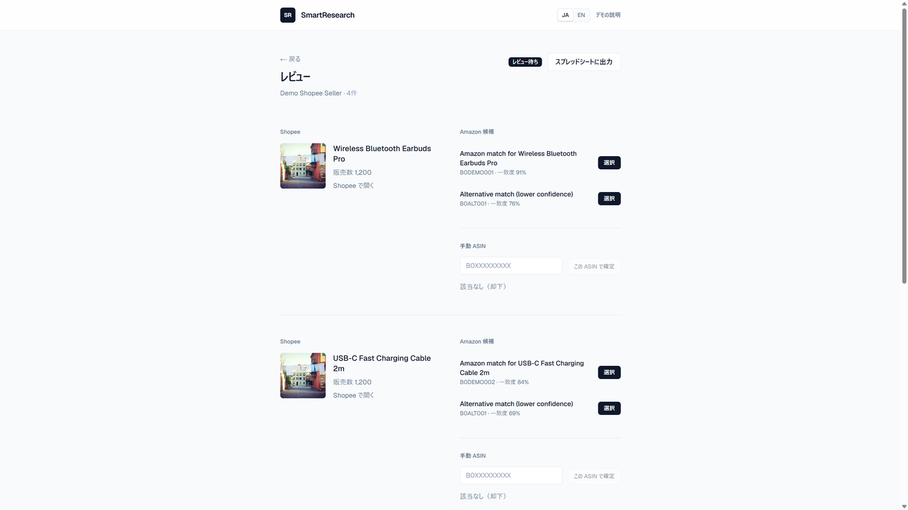

# SmartResearch-HQ｜売れている商品を調べ、仕入れ候補を見つける

[](./README.md) [](./README.en.md)

**海外通販サイト「Shopee（ショッピー）」の商品を調べ、Amazonで同じ商品の候補を探すアプリです。**  
アプリが見つけた候補を人が確認し、仕入れを検討するための一覧にまとめます。

**[デモを試す](https://smart-research-hq.vercel.app)** · [サービス紹介・活用例（9枚／日本語）](https://docs.google.com/presentation/d/19menY9qCy_Skjt85iv5y2VLB4bGUbp6h/edit)

> 公開デモはサンプルデータで動きます。実際のショップ調査やGoogleスプレッドシートへの保存は行いません。説明資料はGoogle Driveの閲覧権限が必要な場合があります。

## こんな方のためのアプリです

- 国内で仕入れた商品を海外で販売したいが、何を仕入れるか迷っている方
- Shopeeで見つけた商品を、Amazonで一件ずつ探し直している方
- 商品の調査結果を一覧に残し、ほかの担当者と共有したい方

商品を探す手間を減らし、価格・送料の確認や仕入れ判断に時間を使うことを目指しています。時間短縮や売上への効果は未測定です。

## 使い方

| 手順 | アプリと利用者がすること |
|---|---|
| 1. 調べたい店を指定 | ShopeeのショップURLを入力します。 |
| 2. 商品候補を見る | アプリが商品情報・販売数と、Amazonの商品候補を表示します。 |
| 3. 同じ商品か確認 | 利用者が型番・容量・色・個数などを確認して候補を選びます。適切な候補がなければ商品番号を手入力するか「該当なし」にします。 |
| 4. 結果をまとめる | 確認した商品の情報を一覧にします。本番向け機能ではGoogleスプレッドシートへ保存できます（初期設定が必要）。 |

候補や一致度の表示は、同じ商品であることを保証しません。最後の確認は利用者が行います。

## 調べた結果はどうなる？

本番向けの出力では、次の情報をGoogleスプレッドシートに保存します。

| 情報 | 内容 |
|---|---|
| Shopeeの商品 | 商品名・商品ページのリンク・商品ID・販売数 |
| 選んだAmazon商品 | 商品ページのリンク・商品を識別する番号（ASIN） |
| 記録 | 出力日時 |

一覧のリンクから商品ページを開き、仕入れ価格や送料を別途確認できます。別の担当者に結果を渡して、続きを調べてもらうこともできます。

## 使用例：Amazonで仕入れて、Shopeeで販売したい

以下は説明用の架空の事例です。商品・販売数・金額は実際の調査結果ではありません。

### 海外で売る商品を探す

田中さんは、Amazonで仕入れた商品をShopeeで販売したいと考えています。何を仕入れるかまだ決まらないため、Shopeeの気になる生活雑貨店のURLをアプリに入力します。

### 商品候補から、同じものを選ぶ

調査結果に「500mLの保温ボトル・販売数120件」が表示され、Amazonの商品候補も見つかりました。田中さんは型番・容量・色・個数を確認し、同じ500mLの商品を選びます。容量の違う350mLの商品は選びません。

販売数は検討の材料の一つです。その数だけで、今後売れるかは判断できません。

### 送料や手数料を引いて、利益を考える

一覧のリンクから価格を調べ、田中さんがアプリの外で費用を計算します。

| 項目 | 仮の金額（円換算） |
|---|---:|
| 販売予定額 | 2,500円 |
| 仕入れ | 1,100円 |
| 配送 | 500円 |
| 販売手数料等 | 350円 |
| 梱包 | 150円 |
| 上の費用を引いた残額 | **400円** |

税金・返品損失・固定費などは含めていないため、最終利益ではありません。配送費が900円になれば残額は0円となり、その条件では仕入れを見送ります。

### 条件を確認して、仕入れるか決める

在庫・販売条件・費用を確認し、条件の合う商品だけ少量の仕入れ候補にします。購入・出品後は実際の費用と売れ行きを見て、追加で仕入れるかを判断します。

**アプリが手伝うのは商品調査・候補の提示・確認結果の整理です。** 利益計算、購入、出品、配送はアプリ外の作業です。売上や利益を保証するものではありません。

## Shopee以外のサイトにも対応できる？

現在は「Shopeeの商品を調べ、Amazonで候補を探す」構成です。調べるサイトや商品を探すサイトは、追加開発で変更を検討できます。

使いたいサイトと必要な情報に応じて、対応可否・開発範囲を確認します。設定だけで任意のサイトに切り替えられる機能ではなく、サイトの仕様・データ取得方法・利用条件によっては対応できません。

## 画面と操作動画

**ショップURLを入力する画面**



**同じ商品か確認して、候補を選ぶ画面**



[短い操作動画を見る](docs/videos/portfolio-demo.webm)

画面の商品情報・一致度はサンプルです。画面に記載された作業時間は目安で、実測した改善効果ではありません。

## 公開デモと本番向け機能の違い

| 項目 | 公開デモ（Portfolio） | 本番向け（Production） |
|---|---|---|
| 商品情報 | サンプルデータ | 外部サイトから取得 |
| Amazon候補 | サンプル候補 | 検索サービスとの連携 |
| 同じ商品かの確認 | 利用者が選択 | 利用者が選択 |
| スプレッドシートへの保存 | 件数表示のみ | Google Sheets連携 |
| 利用準備 | ブラウザで体験 | 外部連携の設定と動作確認が必要 |

本番向け機能は公開デプロイしていません。

---

## 開発者向け：構成と動作モード

FastAPIとNext.jsを使い、同じコードベースの動作を `APP_MODE` で切り替えます。

- `portfolio`：インメモリのサンプルデータで動作。PostgreSQL・Redis・APIキーは不要です。
- `production`：Playwright、Redis + ARQワーカー、PostgreSQL、Amazon検索、Google Sheetsを利用します。候補検索は差し替え可能で、既定はAmazon PA-APIによるタイトル検索です。Geminiは任意です。

画面デザイン：[Soft Paperの設計方針](docs/design/brief.md)  
デモ用の商品画像：`frontend/public/demo/`

---

## 技術スタック

組織方針: **[docs/tech-stack-policy.md](docs/tech-stack-policy.md)**（本リポ = **プロファイル B** — FastAPI パイプライン）。新規業務 SaaS は **プロファイル A**（Laravel）。

- **フロント:** Next.js 16、TypeScript、Tailwind CSS
- **バックエンド:** FastAPI、Pydantic v2
- **Portfolio インフラ:** Vercel（UI）+ Render（API）— [デプロイ手順](docs/deployment-guide.md)
- **Production インフラ:** PostgreSQL 16、Redis 7、Playwright、Google Sheets API

---

## クイックスタート（ローカル・portfolio）

Postgres と Redis は **不要** です。

```bash
bash scripts/bootstrap-local.sh

# ターミナル 1 — API
cd backend && source .venv/bin/activate
uvicorn app.main:app --reload --port 8000

# ターミナル 2 — UI
cd frontend && npm run dev
```

http://localhost:3000 を開く → Shopee ショップ URL を入力 → 候補をレビュー → エクスポート。

ヘルス: `GET http://localhost:8000/api/v1/health` → `{ "status": "ok", "mode": "portfolio", ... }`

---

## クイックスタート（ローカル・production — 非公開）

**公開デプロイはしていません。** Docker（Postgres + Redis）、Playwright、必要に応じて Amazon PA-API キーが必要です。Gemini は任意です。

```bash
bash scripts/start-production-local.sh
# .env を編集: APP_MODE=production, AMAZON_PAAPI_*（docs/production-local-setup.md 参照）
```

チェックリスト: **[docs/production-local-setup.md](docs/production-local-setup.md)** · M2 スモーク: `bash scripts/smoke-m2.sh`

---

## デプロイ（portfolio）

1. Render で [render.yaml](render.yaml) を適用（`APP_MODE=portfolio`）。
2. `frontend/` を Vercel にデプロイ。`NEXT_PUBLIC_API_URL` に Render API のベース + `/api/v1` を設定。
3. Render の `ALLOWED_ORIGINS` に Vercel の URL を設定。

手順: **[docs/deployment-guide.md](docs/deployment-guide.md)**
障害対応（404、CORS、CLI）: **[docs/deployment-troubleshooting.md](docs/deployment-troubleshooting.md)**

ワンコマンド再デプロイ: `bash scripts/portfolio-vercel-deploy.sh redeploy`

---

## リポジトリ構成

```
├── docs/           # 設計・アーキテクチャ
├── frontend/       # Next.js ダッシュボード・レビュー UI
├── backend/        # FastAPI（portfolio 時は Mock）
├── render.yaml     # Render Blueprint（portfolio API）
├── docker-compose.yml
└── scripts/        # bootstrap、CI、スモークテスト
```

---

## ドキュメント

| ドキュメント | 内容 |
|--------------|------|
| [CONTEXT.md](CONTEXT.md) | ドメイン用語・セキュリティ・工学原則 |
| [エージェント索引](docs/agents/README.md) | セキュリティ、YAGNI/フェイルファスト/テスト、ADR |
| [プロジェクト計画書](docs/プロジェクト計画書.md) | 目的・スコープ |
| [アーキテクチャ](docs/architecture.md) | 二刀流設計・データフロー |
| [設計書](docs/design.md) | UI 原則 |
| [API 仕様](docs/api-specification.md) | REST 契約 |
| [デプロイ手順](docs/deployment-guide.md) | Vercel / Render の環境変数 |
| [技術スタック方針](docs/tech-stack-policy.md) | 組織 Must/Choose、本リポ = プロファイル B |
| [セキュリティスキャン](docs/security-scanning.md) | CI secret / CodeQL ガードレール |
| [ドキュメント規約](docs/doc-conventions.md) | README の言語切り替え・公開ドキュメントの規約 |
| [Git フック](docs/git-hooks.md) | ローカル pre-commit / post-push の導入 |

---

## 開発

### 前提環境

| 項目 | 備考 |
|------|------|
| OS | Windows では **WSL Ubuntu** 推奨（Git Bash + UNC パスは避ける） |
| Python | 3.12 |
| Node.js | 20 LTS |
| Docker | 任意 — production 検証時のみ |

```bash
bash scripts/ci-check.sh   # Ruff + pytest + ESLint + build（CI と同等）
```

任意 — Git フック（pre-commit チェック + post-push PR 同期）: `bash scripts/install-git-hooks.sh` — [docs/git-hooks.md](docs/git-hooks.md) を参照。

Production 検証（任意）: `.env.example` → `.env` をコピーし、`APP_MODE=production` で `docker compose up -d postgres redis`。

### 主な環境変数（portfolio）

| 変数 | 設定先 | 説明 |
|------|--------|------|
| `APP_MODE` | バックエンド | `portfolio`（Mock）または `production` |
| `NEXT_PUBLIC_API_URL` | フロント | API ベース URL（例: `http://localhost:8000/api/v1`） |
| `ALLOWED_ORIGINS` | バックエンド | デプロイ先フロントの CORS origin（カンマ区切り） |

Production 専用の変数（PA-API、Gemini、Sheets）は `.env.example` を参照。

---

## ロードマップ

- [x] Phase 1 — 設計、モノレポ、docs
- [x] Phase 2 — スクレイピング、マッチング、Sheets、ワーカー
- [x] Phase 3 — ジョブポーリング、手動 ASIN UI
- [x] Phase 4 — Portfolio デプロイ、Soft Paper UI、スクショ / デモ動画

---

## ライセンス

Private / portfolio 利用。Portfolio 版ではスクレイピング内部やプロプライエタリなプロンプトは含みません。
